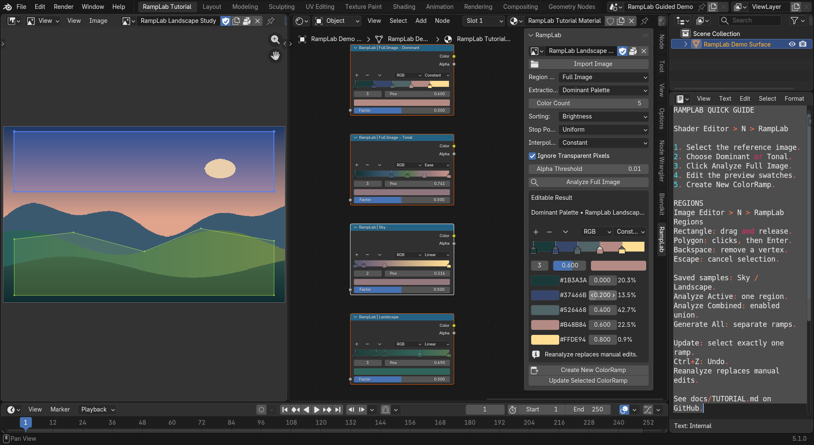
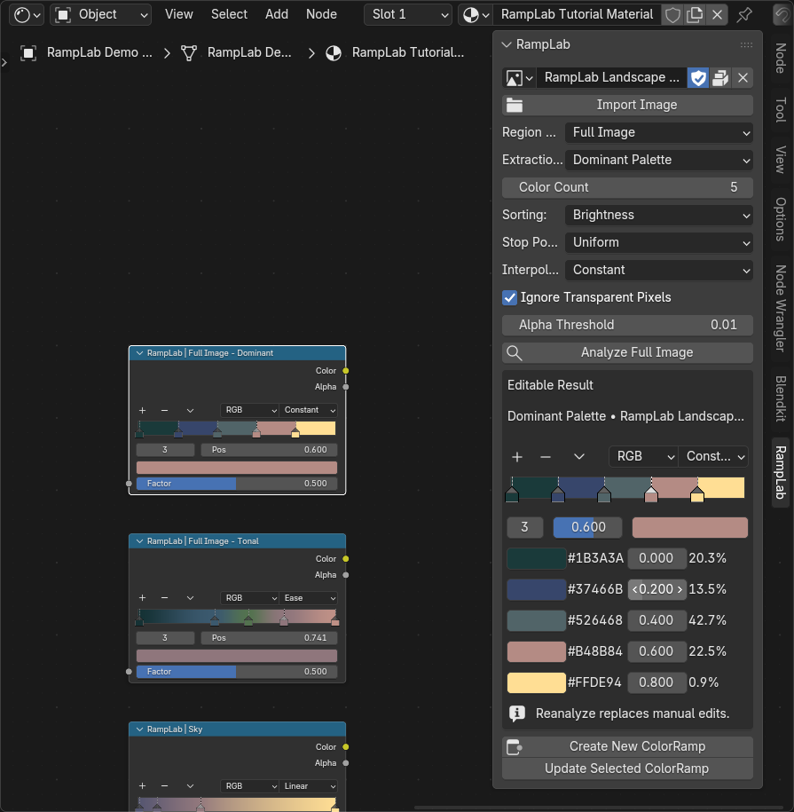
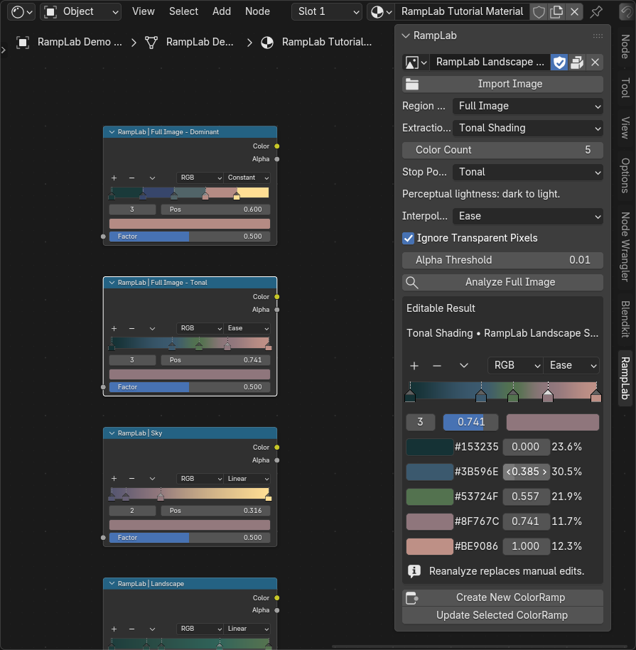
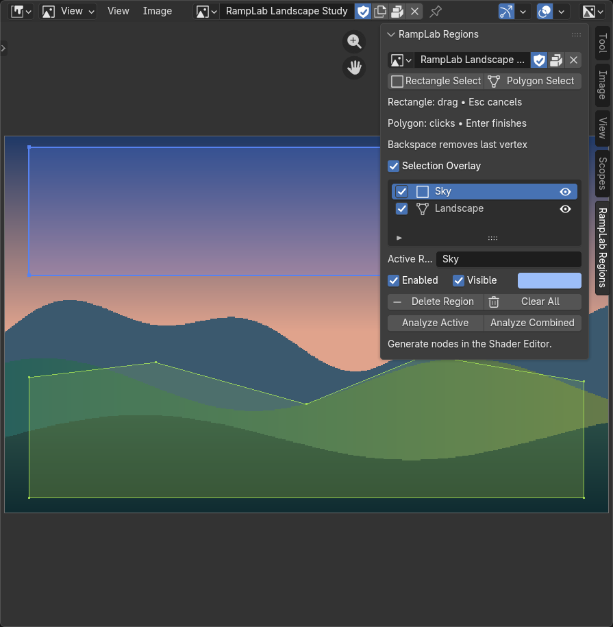
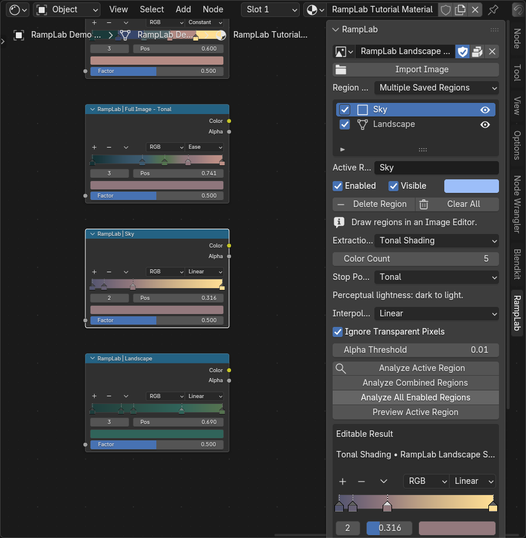

# RampLab: from reference image to ColorRamp

This guide uses actual captures from Blender 5.1.0. The sample landscape is a
generated color study included with the project. Start with it or use your own still image.

**You need:** RampLab installed, a reference image, and an object with an editable
material. You do not need Blender MCP, an API key, or an internet connection for extraction.

## 1. Install and open the panels

Download `ramplab-1.0.1.zip` from [Releases](https://github.com/eddylaucheukwa-cloud/ramplab/releases/latest).
In Blender, use **Edit → Preferences → Get Extensions → menu → Install from Disk**
and enable RampLab. Do not unpack the ZIP or install GitHub's source-code ZIP.

Open a **Shader Editor**, hover it, and press **N**. Click the **RampLab** sidebar tab.
For selections, open an **Image Editor** next to it. Hover that editor, press **N**,
and click **RampLab Regions**.

Blender keyboard shortcuts act on the editor under your pointer. RampLab does not
change your editor type or workspace automatically.

*The Shader Editor panel controls extraction and node output. Image selections
are edited in the Image Editor. Both panels share the same reference and regions.*

## 2. Choose a reference image

In the Shader Editor's RampLab panel:

1. Click **Import Image** and select a file, or choose an existing Blender image
   from the image dropdown at the top of the panel.
2. Set **Region Mode → Full Image** for your first analysis.
3. In the Image Editor, select the same image. If the two images differ, use
   **Show Reference Here** in RampLab Regions. **Use This Editor Image** makes the
   image already open in the editor the shared reference instead.

PNG and JPEG references are convenient starting points. Packed images work too.
The **Import Image** button loads the reference; it does not analyze it yet.

## 3. Extract the dominant palette

Choose these settings:

| Setting | Start with | What it controls |
| --- | --- | --- |
| Extraction Mode | **Dominant Palette** | Representative perceptual color groups |
| Color Count | **5** | Requested distinct colors, from 3 to 8 |
| Sorting | **Brightness** | Darkest to brightest |
| Stop Positioning | **Uniform** | Equal-width palette bands |
| Interpolation | **Constant** | Distinct bands without blending |
| Ignore Transparent Pixels | **Enabled** | Exclude sufficiently transparent samples |

Click **Analyze Full Image**. RampLab builds an editable preview and shows the
original sample proportions alongside the swatches.

*Use Brightness for dark-to-light palette ordering. Hue orders perceptual hue;
Frequency puts the largest sample group first. Frequency is not a shading gradient.*

If you request five colors from a solid-color image, one distinct color is enough.
Blender requires two ramp elements, so RampLab duplicates that solid color at the endpoints.

## 4. Review and edit the result

Before creating a node:

- Click a preview swatch to adjust its color.
- Drag ramp handles or edit the position fields to move stops.
- Switch **Constant**, **Linear**, or **Ease** interpolation to change blending.
- Use the hex values as an sRGB reference. The stored colors remain scene-linear
  for Blender's material nodes.

The preview uses Blender's native ColorRamp control. Your color, position, and
interpolation edits are copied to output nodes.

**Changing analysis settings requires explicit reanalysis before output.**
**Reanalyze replaces manual edits.** Interpolation changes alone do not run clustering.
After painting or reloading source pixels, explicitly analyze again to refresh the snapshot.

## 5. Create an editable ColorRamp node

Click **Create New ColorRamp** in the Shader Editor's RampLab panel. A new
ColorRamp appears beside the existing graph and is selected.

The generated node is a normal Blender ColorRamp. Edit it directly, duplicate it,
or connect it to your material as needed. RampLab leaves it **unconnected** so it
does not change the meaning of your material graph automatically.

Each deliberate click on Create makes another independent node. Use Update when
you want to change an existing node instead.

## 6. Try Tonal Shading

Choose **Extraction Mode → Tonal Shading** and click **Analyze Full Image**.

- **Tonal** positioning places stops using normalized perceptual lightness.
- **Uniform** positioning spaces the stops evenly.
- **Constant** creates bands, **Linear** blends between stops, and **Ease** smooths the blend.

Hue and Frequency sorting are hidden in this mode, preserving dark-to-light order.

*Tonal Shading extracts colors from lightness bands. It does not physically detect
shadows or identify the object's true material color. Adjust the result for your art direction.*

## 7. Save a rectangle or polygon region

In **Image Editor → N → RampLab Regions**, display the shared reference first.

### Rectangle

1. Click **Rectangle Select**.
2. Press the left mouse button over the image.
3. Drag around the area you want to sample.
4. Release to save the selection. Dragging in either direction works.
5. Change **Active Region** to a descriptive name, such as **Sky**.

### Polygon

1. Click **Polygon Select**.
2. Left-click to place vertices around the area.
3. Press **Enter**, or double-click, to close and save it.
4. Press **Backspace** to remove the latest vertex while drawing.
5. Press **Escape** or right-click to cancel without saving.

Concave polygons work. Use at least three non-collinear vertices, avoid crossing
edges, and keep the polygon within the 64-vertex limit. Negligible selections and
regions containing no pixel centers are rejected with an explanation.

*The saved Sky rectangle and Landscape polygon are separate selections. Enabled
controls inclusion in combined/all-region operations; the eye controls only visibility.*

Normalized coordinates keep selections attached to the image during zoom and pan.
They do not permanently crop or modify the reference.

## 8. Extract from a region or combine regions

Return to the Shader Editor and choose **Region Mode → Multiple Saved Regions**.
Select the region in the list, then choose an extraction mode.

| Action | Result |
| --- | --- |
| **Analyze Active Region** | Only the active selection contributes pixels |
| **Analyze Combined Regions** | One palette from the union of all enabled selections; overlaps counted once |
| **Analyze All Enabled Regions** | A separately editable result for each enabled region |
| **Preview Active Region** | Leave the combined preview and display the active region's result |
| **Generate Ramps for All Regions** | One independent, labeled ColorRamp per enabled region |

*The selected Sky region contributes its own tonal statistics. Landscape pixels
outside it do not enter that analysis.*

Click **Create New ColorRamp** to output whichever full-image, active-region, or
combined result is currently shown. Generate All analyzes missing results and
retains existing valid edited results; changed settings require explicit reanalysis.

## 9. Update a selected ColorRamp

1. Select the ColorRamp you want to update in the Shader Editor.
2. Deselect every other node, so **exactly one ColorRamp** is selected and active.
3. Confirm the RampLab preview shows the result you want.
4. Click **Update Selected ColorRamp**.

In the example below, a Sky swatch was edited in the preview, then copied to the
existing Sky node with Update Selected ColorRamp.

*Update replaces that ramp's elements and interpolation. It preserves unrelated
nodes, links, and material properties. Press **Ctrl+Z** to undo.*

## 10. Save your work

Save the `.blend` file to keep the named regions, active selection, and editable results.
For external references, use Blender's **File → External Data → Pack Resources**
when you need to include the source image in the project.

Blender converting absolute image paths to relative paths during a normal save is
handled in 1.0.1. Moving or replacing an externally referenced image can still
invalidate its stored source-path checks; recreate the regions on the intended
source when RampLab warns that dimensions or paths changed.

The bundled [example project](../examples/README.md) contains a packed reference
with no external source path, so the sample selections remain portable.

## Common questions

**I cannot see RampLab.** Hover a Shader Editor and press N, then select the RampLab
tab. Verify the extension is enabled. Region tools are in the Image Editor's separate tab.

**Rectangle Select is disabled or reports different images.** Use Show Reference Here
so the Image Editor and RampLab point to the same image datablock.

**Create reports no material.** Select an object with a local editable material and
use an object-material Shader Editor, rather than a World shader or another editor type.

**Update refuses my selection.** Select exactly one valid ColorRamp and make it active.

**The colors differ from the rendered material.** Render view transforms such as AgX
affect appearance. RampLab's hex values are sRGB, while its node colors are scene-linear.

**A region is empty.** Enlarge it or check transparency filtering. Tiny regions must
contain at least one image pixel center.

**Settings changed and output is blocked.** Reanalyze explicitly. Save your manual
edits to a generated node first if you want to preserve them before reanalysis.
